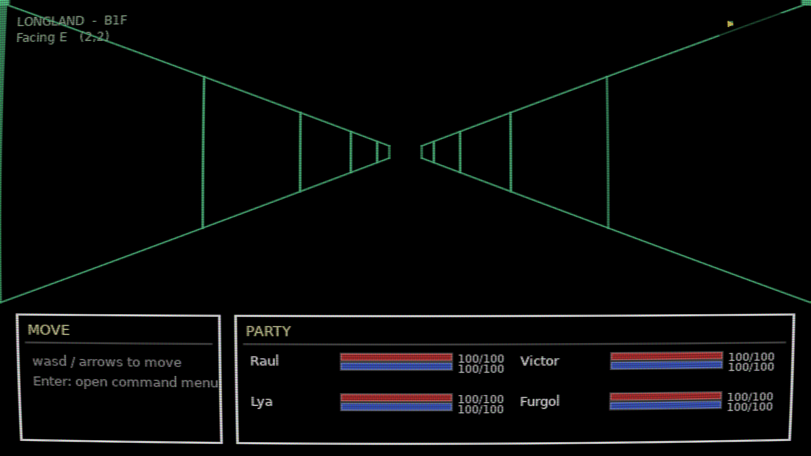
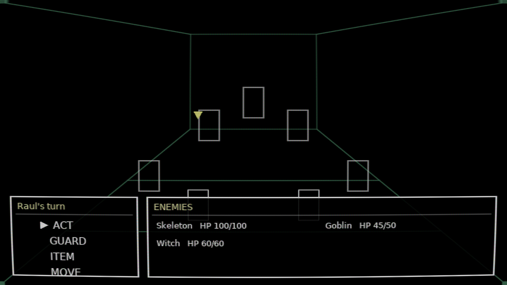
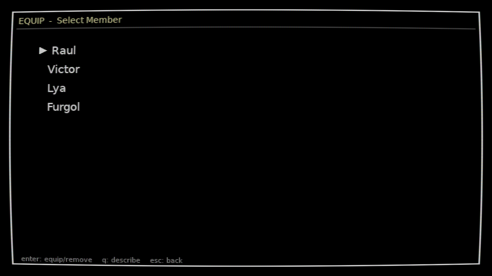
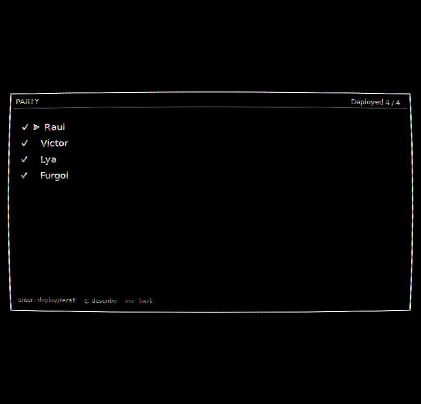

# Longland

- **Genre:** Turn-based RPG (first-person dungeon crawler with turn-based party battles)
- **Language(s):** Lua
- **Libraries/engine:** LOVE 11.5 (LOVE2D); no other libraries
- **Coding concepts demonstrated:**
  - Metatable classes and modules (`src/lib/class.lua`)
  - Screen stack / state machine (`src/core/screen.lua`, `src/screens/`)
  - Action-value turn scheduler (`src/game/battle/scheduler.lua`, `src/game/battle/battle.lua`)
  - Enemy AI with weighted random targeting (`src/game/battle/ai.lua`)
  - Effects list and event bus for abilities and status effects (`src/game/battle/effects.lua`)
  - Data-driven content tables for units, items and abilities (`src/game/content/`)
  - ASCII tile map parsing and grid movement (`src/dungeon/map.lua`, `src/screens/dungeon.lua`)
  - Pseudo-3D wireframe projection of the dungeon view (`src/dungeon/view.lua`)
  - GLSL fragment shader for a CRT effect and canvas scaling/letterboxing (`src/core/crt_shader.lua`, `src/core/video.lua`)
  - Sprite-sheet animation (`src/core/sprite.lua`, `src/game/sprites.lua`)
  - Headless self-tests with assertions (`src/game/*test.lua`)
- **Dates:** July 2026 (source files last modified 2026-07-24)
- **Status:** Unfinished prototype. The exploration, party management and battle loop are playable; the game has one floor and no save system.

## Screenshots

| Exploration | Battle |
|---|---|
|  |  |

| Equipment | Party |
|---|---|
|  |  |

The battle screenshot shows empty boxes where enemy and hero sprites would be, because the sprite art is not included in this repository (see Credits).

## What this is

A small Wizardry-style dungeon crawler. The player walks a grid dungeon in first person, drawn as a green wireframe, and random encounters start turn-based battles with a party of four. The aim was to build the core systems: a party and equipment model, and a battle system where turn order comes from an action-value scheduler (each unit rolls a delay from its speed, and the lowest value acts next).

Implemented:

- Title screen, command menu (Equip, Item, Party, Stats, Descend), reusable menu/panel/textbox UI.
- First-person movement with a minimap, safe rooms that restore MP, and a 12% encounter chance per step elsewhere.
- Four heroes and three enemies, equipment slots, a shared inventory and a deploy limit of four.
- Battles with front/back rows, melee/ranged/magic attacks, dodge, block and crits, abilities with HP/MP costs, status effects, guard and row moves.
- A CRT shader over the whole screen (F11 toggles fullscreen).

## Status details

- There is one hard-coded 12x9 floor ("B1F"). Descend just starts a random fight; there is no second floor.
- Continue on the title screen and saving are not implemented.
- Enemy and hero sprites were placeholders (several enemies reuse unrelated sprites), and no sprite art is shipped here. Without it the battle screen draws plain boxes.
- No sound. No custom font (LOVE's default font is used).
- Some code comments mention a design document that is not part of this repository.

## Build and run

Install [LOVE](https://love2d.org) 11.5, then from the repository root:

    love .

Controls: WASD or arrow keys to move and navigate menus, Enter or Space to confirm, Escape or Backspace to cancel, Q to describe.

Headless checks (each prints `RESULT: ALL CHECKS PASSED` and quits):

    love . datatest
    love . flowtest
    love . battletest
    love . screentest
    love . dungeontest

`love . selftest [dungeon|encounter|battlecmd|equip|party|stats|item]` boots a screen, saves a screenshot to LOVE's save directory and quits.

## AI assistance

This project was built with Claude Code. The exact split between my own design and generated code is not recorded in the repository.

## Credits

- Written in Lua for the LOVE framework.
- The prototype used third-party pixel-art sprite packs and background images for placeholders. They are not redistributed here because their licences could not be confirmed.
